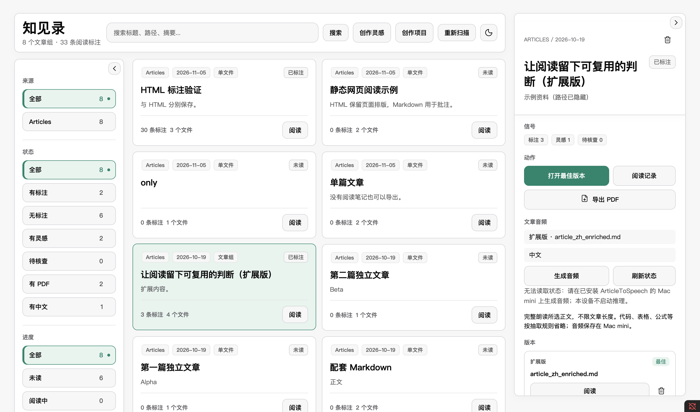
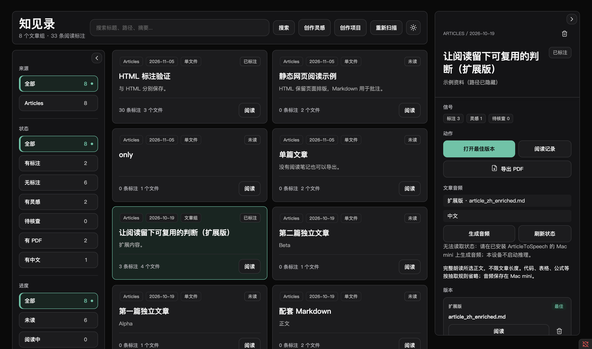

# Reading Capture · 知见录

简体中文 | [English](README.en.md)

在 Obsidian 中集中浏览文章、保留网页原始排版、边读边标注，再把想法整理成可复用的阅读记录。

Reading Capture 提供文章库「知见录」、Markdown 阅读器、HTML 预览和阅读记录页。基础阅读与标注不需要 AI 模型、Topic Miner 或其他自动化工具。

> 本文说明 `personal/topic-miner` 分支的当前功能。源码中的插件版本号为 `0.4.4`；开发分支可能包含尚未进入 GitHub Release 的更新，请以实际安装包为准。

**浅色主题**



**深色主题**



*两张图均为当前版本在 Obsidian 中的实际截图，使用匿名演示数据；目录路径已隐藏，不包含私人文章、账号或本机绝对路径。*

## 当前界面与阅读体验

- **顶部工具栏固定**：向下滚动文章列表时，知见录标题、搜索框、创作入口、重新扫描和主题按钮保持可见。
- **左右区域独立收起**：左侧筛选向左收起，右侧详情向右收起，点击边缘箭头展开；已有筛选和文章选择保留。
- **卡片自动排版**：根据可用宽度显示一至四列，宽屏可显示三列或四列；窄窗口侧栏以抽屉方式打开。
- **统一深浅配色**：工具栏末尾的太阳/月亮按钮切换主题，阅读器、阅读记录、创作灵感、创作项目和插件弹窗同步跟随。
- **记住界面选择**：主题和两侧展开状态按本机、本仓库保存，重开后恢复。不修改 Obsidian 全局主题，也不覆盖 HTML 原文配色。
- **更清晰的文字层级**：界面采用苹方优先的系统无衬线字体；Markdown 阅读器默认使用黑体，可在「Aa 阅读设置」切换宋体、调整字号和行距。

## 主要功能

| 功能 | 用途 |
| --- | --- |
| 知见录 | 按来源、标注状态和阅读进度浏览文章，搜索标题、路径和摘要 |
| 文件版本 | 将相关 Markdown、PDF、HTML 版本集中展示，选择需要阅读的版本 |
| Markdown 阅读器 | 沉浸阅读、文字高亮、记录想法与阅读进度 |
| HTML 预览 | 在 Obsidian 内呈现静态网页排版，支持文字和整图标注 |
| 阅读记录 | 集中查看想法、创作灵感和待核查事项，复制引用或回到原文 |
| PDF 导出 | 导出文章，可选择附带阅读笔记；仅桌面端 |
| 创作工作台 | 从灵感或已有资料建立创作项目；自动生成流程需额外配置 |

## 安装与更新

目前采用手动安装。下载仓库 [Releases](https://github.com/kingqiu/reading-capture-plugin/releases) 中提供的 `reading-capture.zip`；GitHub 的 `Source code.zip` 是源码，不能直接作为插件安装。

1. 解压安装包，将完整的 `reading-capture` 文件夹放入仓库的 `.obsidian/plugins/`。
2. 确认目录没有多套一层：`main.js`、`manifest.json`、`styles.css` 和配套模块应直接位于插件目录内。
3. 在 Obsidian「设置 → 第三方插件」中启用 Reading Capture。

```text
你的仓库/
└── .obsidian/plugins/reading-capture/
    ├── main.js
    ├── manifest.json
    ├── styles.css
    ├── reading-core.js
    └── …安装包中的其他配套文件
```

**更新前先备份整个旧插件目录。** 用新安装包中的运行文件覆盖旧文件，保留原有 `data.json` 设置，然后关闭并重新启用插件，或重启 Obsidian。阅读记录独立保存在仓库中，更新插件时不要删除这些笔记及附件。

跨电脑更新见 [操作说明](docs/cross-device-plugin-update.md)。如需使用本分支尚未发布的功能，可按文末步骤从源码打包。

## 第一次使用

1. 打开「设置 → Reading Capture」。
2. 设置 **知见录扫描目录**：每行填写一个仓库内的相对目录，例如 `Articles` 或 `Research`。支持 Markdown、PDF、HTML/HTM。
3. 按需设置 **排除目录**；插件默认跳过阅读记录目录和 `.obsidian`。
4. 确认 **阅读笔记根目录**，默认是 `Reading Capture/notes`。
5. 在命令面板运行 **Reading Capture: 打开知见录**。新增文件后可点击「重新扫描」。

点击文章卡片查看详情，点击「阅读」或「打开最佳版本」进入正文，也可在右侧「版本」区选择具体文件。有 Markdown 时保持已有的版本优先级；只有 HTML 时也可直接打开。

## 阅读与标注

### Markdown

选中文字后右键或使用 Reading Capture 命令，保存高亮、普通想法、创作灵感或事实待核查事项。不选中文字时也可记录整篇想法。阅读器侧栏显示已有记录，支持回到原文位置和打开阅读记录页。

阅读记录以 Markdown 文件集中保存，可继续在 Obsidian 中查看、编辑和整理。原文被大幅修改后，部分标注可能无法精确定位；记录本身仍保留。

### HTML / HTM

知见录「版本」区显示 HTML 文件名，点击预览即可在 Obsidian 标签页中查看实际页面，而不是源代码。

- 同目录同名 Markdown 优先关联；目录中的 Markdown 都属于同一文章组时，不同名 HTML 也可加入。不能确定关联时，HTML 独立显示。
- 支持仓库内相对路径引用的 CSS、图片和字体，保留页面原有排版与配色。
- 网页脚本、嵌入页面和自动网络资源加载被禁用。依赖脚本或在线资源的页面可能显示不完整。
- 顶部工具条可收起；「刷新」重新读取页面及资源，标注侧栏也可展开或收起。
- 选中文字后右键可高亮、记录想法、灵感或待核查事项。图片右键支持整图笔记，包括本地图片、内嵌图片、自适应图片和静态 SVG 图表。

HTML 标注使用同一套集中阅读记录目录，但与 Markdown 分别关联各自来源版本。图片副本保存在阅读记录目录的 `attachments/html/`，按内容去重；原始 HTML 不写入标注。

刷新或重开后会恢复高亮、图片标记和回跳。原文变化且无法可靠匹配时，记录显示「未定位」，保留摘录和图片副本。暂不支持图片局部框选、CSS 背景图或 canvas 标注。HTML 的音频和 PDF 导出入口仍依赖已有的 Markdown/PDF 版本。

HTML 功能已在 macOS 桌面端验证，移动端尚未验收。

## 导出 PDF

在知见录右侧详情中点击「导出 PDF」，每次导出一个文章版本。默认优先中文译文，也可选择原文。

- 默认只导出正文；勾选「同时导出我的阅读笔记」后可附带文章组的笔记，AI 汇总需另行勾选。
- Markdown 可将笔记放在对应正文后，或统一置于文末；来自其他版本和无法定位的笔记保留在文末。
- 原生 PDF 保留原页，在文末追加笔记。
- 缺图时可重试，或明确选择忽略并保留缺图标记。

转换在本地完成，通过系统对话框另存。当前在 macOS Obsidian 桌面端验证；移动端不提供此功能。加密、损坏或带签名的 PDF 需要先提供可处理的副本。

## 创作灵感与创作项目

「创作灵感」可以独立管理阅读时手动保存的想法。有本地 Topic Miner 报告时，也可显示其生成的选题候选；Topic Miner 是可选集成。

本开发分支还提供创作项目工作台：从灵感策划，或将已有文章、笔记、PDF 改编为微信公众号文章和小红书图文。支持阶段状态、样章比较、图片预览、单图重试、内容审核和发布包整理。

自动生成流程需要另行配置本机 Skill Runner、相关 Skill 以及项目和发布目录。是否调用外部模型或服务取决于这些工具的配置；启动前请确认所用工具的数据处理方式。基础浏览与阅读标注无需这些配置。

## 常用命令

在 Obsidian 命令面板搜索 `Reading Capture`：

- 打开知见录 / 打开阅读器视图
- 标注选中文本并记录想法 / 快速高亮选中文本
- 记录当前想法 / 加入创作灵感 / 加入事实待核查
- 打开当前文件的阅读记录 / 标记当前阅读为已完成
- 打开创作灵感 / 打开创作项目
- 重建阅读索引 / 导出诊断日志

## 常见问题

**插件列表中找不到插件或加载失败**：确认下载的是安装包，目录没有多套一层，并完整复制所有配套文件。

**更新后仍是旧界面**：关闭并重新启用插件，或重启 Obsidian。确认更新的是当前打开仓库中的插件目录。

**知见录找不到文章**：检查扫描目录和排除目录，使用仓库相对路径，再重新扫描。移动文章后可能需要重建阅读索引。

**标注不能跳回原文**：原文内容、文件路径或图片可能已经变化。先确认来源文件仍存在；「未定位」不会删除原有记录。

**需要报告问题**：运行「Reading Capture: 导出诊断日志」，报告保存在 `Reading Capture/diagnostics/diagnostic-report.md`。分享前检查日志中的设置、路径和其他个人信息，并先做脱敏；请勿直接上传私人仓库截图、笔记或 `data.json`。

## 从源码构建

需要 Node.js 和 npm。在项目目录运行：

```sh
npm ci
npm run release:check
```

该命令运行测试、构建安装包并检查包结构。安装目录为 `dist/reading-capture/`，压缩包为 `dist/reading-capture.zip`。源码分支的构建结果以该分支中的模块和版本声明为准，不代表其他已安装版本的附加集成。

## 许可证

[Apache License 2.0](LICENSE)。
