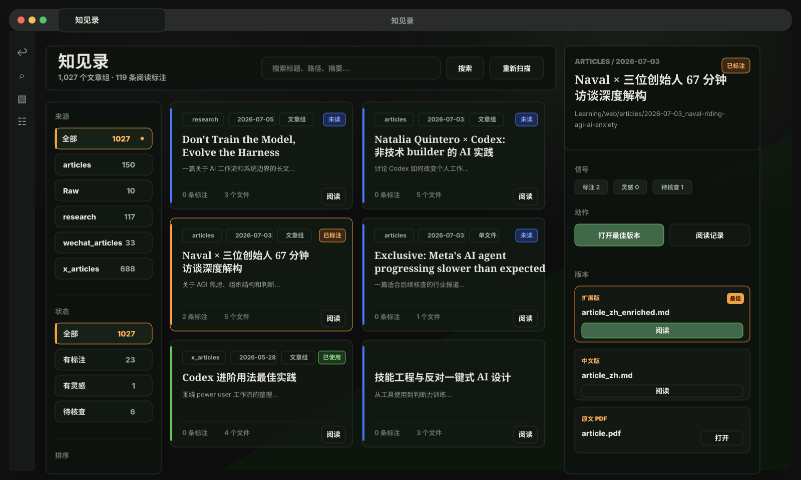
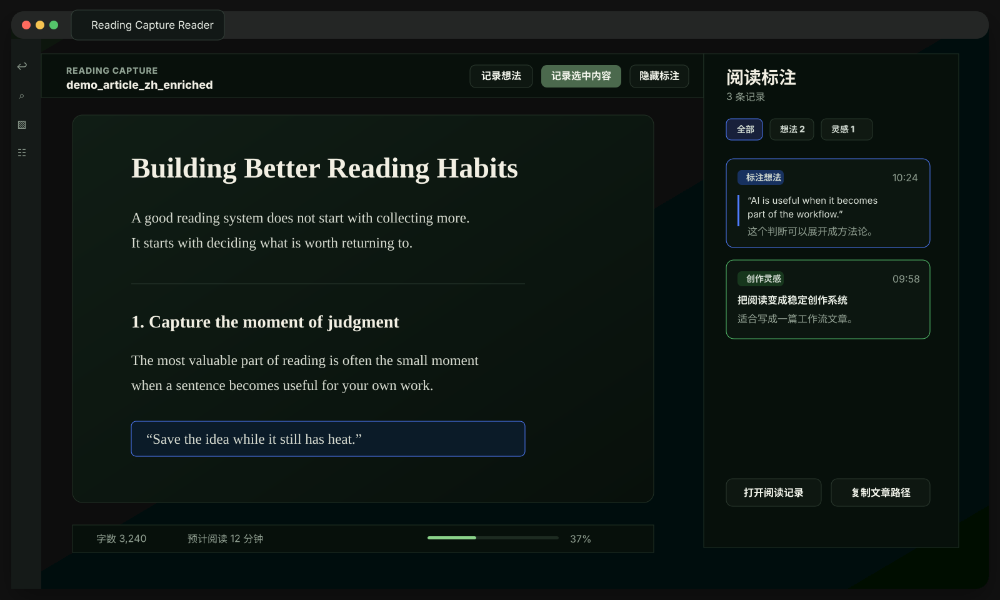
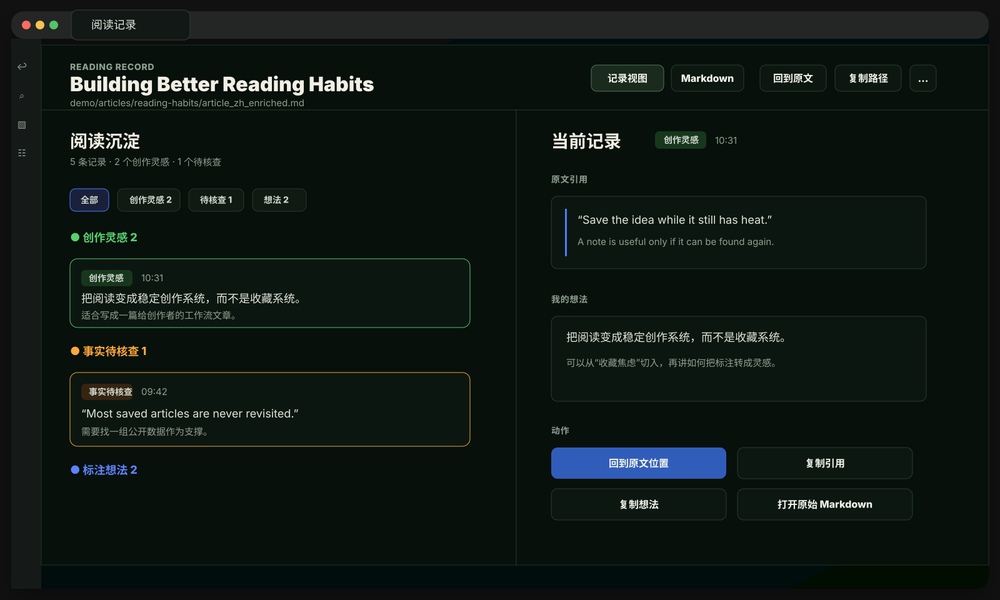
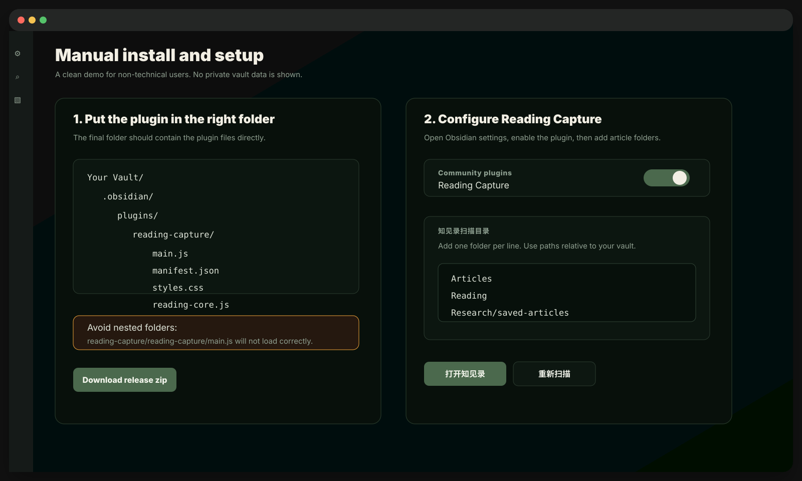

# Reading Capture

简体中文 | [English](README.en.md)

Reading Capture 是一个 Obsidian 插件，适合经常保存文章、做深度阅读、写笔记、积累创作灵感和素材的人使用。

它会在 Obsidian 里提供一个更适合阅读的界面，一个用来浏览文章的 `知见录`，以及一个专门查看阅读标注和想法的阅读记录页。

当前版本：`0.4.4`

> 跨电脑更新插件（含可直接交给 Agent 的操作说明）：[docs/cross-device-plugin-update.md](docs/cross-device-plugin-update.md)

## HTML 阅读与标注

知见录支持 `.html` 和 `.htm` 文件。在设置的扫描目录中，重新扫描后即可在“版本”区看到 HTML 文件名，点击“预览”在 Obsidian 标签页内查看原始排版；顶部“刷新”会重新读取页面及配套资源。

同目录的同名 Markdown 优先关联；目录中的 Markdown 都属于同一文章组时，不同名 HTML 也可加入。无法确定关联的 HTML 独立显示。Markdown 保持默认阅读优先级，只有 HTML 也能直接打开。

支持仓库内的相对路径图片、CSS 和字体，保留页面自身配色。网页脚本、嵌入页面和自动网络资源加载被禁用，因此依赖脚本或在线资源的页面可能显示不完整。HTML 音频和 PDF 导出仍使用已有的 Markdown/PDF 版本。

顶部工具条压缩为约 36px，可收起并记住选择。选中文字后右键可高亮、记录想法、灵感或待核查事项；图片右键可添加整图笔记，包含本地图片、内嵌图片、自适应图片和静态 SVG 图表。工具条提供整篇想法与可收起的标注侧栏。

标注复用现有集中阅读记录目录；HTML 与 Markdown 分别关联各自来源版本。图片副本保存到阅读记录目录的 `attachments/html/`，按内容去重。刷新和重开后恢复高亮、图片标记及回跳；原文变化且无法可靠匹配时显示“未定位”，保留摘录和图片副本。原始 HTML 不写入标注。暂不支持图片局部框选、CSS 背景或 canvas 标注。

本功能已在 Mac 桌面端 Obsidian 验证；移动端尚未验收。

当前开发分支：`personal/topic-miner`

## 本分支近期更新（2026-07-26 至 2026-07-28）

这一轮重点把“阅读灵感 → 创作项目 → 平台内容 → 发布包”的流程补成了可检查、可恢复的工作台，而不是让用户在看不到内容的情况下连续点击按钮。

- 新增并完善 `创作项目` 工作台入口：可从知见录和创作灵感进入；项目、当前平台和八个阶段都有明确状态。
- 支持两条创作路径：从创作灵感开始完整策划，或从已保存的文章、笔记、PDF 直接改编为微信公众号文章或小红书图文。
- 小红书方案支持三套模板与配色的样章对比，可直接查看实际图片、继续生成新的样章批次，并在确认后生成整套卡片与发布文案。
- 配图任务支持逐张查看、单图重试、替换 Skill、重写提示词，以及用自然语言要求 Agent 修改某一页；已成功的页面不会被失败页面或重试任务覆盖。
- 小红书卡片视觉审核与发布文案质检现为两个清晰阶段：视觉通过后留在第 7 步展示全部卡片和文案预览，文案质检不会再错误跳回第 6 步或显示机器清单。
- 内容审核改为优先展示可读缩略图和完整文案区域；不再把卡片清单、哈希和路径作为人工审核主界面。
- Runner 队列增加了更明确的运行、等待、失败和重试反馈；重新入队后，项目页面会即时显示状态，而不是只出现短暂提示。
- 统一创作项目、项目选择器、弹窗和发布复盘弹窗的视觉样式，补齐窄屏、长标题、下拉选项和按钮可见性问题。

这部分仍是面向个人工作流的开发分支功能。使用前请先确认创作项目根目录、发布目录与本机 Skill Runner 配置；生成内容、图片和发布快照都会保留在本地 Obsidian 仓库中，供后续继续编辑和复盘。

## 导出文章与阅读笔记为 PDF（桌面端）

在知见录中选择文章，点击右侧详情栏的 **导出 PDF**。默认优先选择中文译文；可改选原文，每次导出一个版本并保留插图。

- 默认仅导出正文。勾选“同时导出我的阅读笔记”后，默认包含整个文章组的笔记；AI 汇总需另行勾选。
- Markdown 默认将紧凑笔记框插在对应正文后，也可选择正文在前、笔记在后的版式。其他版本或无法准确定位的笔记完整保留在文末。
- 原生 PDF 保留原页，将笔记连续追加在文末；多条短笔记可共用一页。
- 缺图时会提示重试，也可明确选择忽略并保留缺图标记。导出使用本地转换，通过系统对话框另存文件。

目前已在 macOS 的 Obsidian 桌面版验证。加密、损坏或带签名的 PDF 需要先提供可处理的副本；移动端不提供 PDF 导出。

## 这个插件能做什么

- 在 `知见录` 里集中浏览你保存过的文章。
- 用更安静的阅读视图打开 Markdown 文章。
- 如果文章目录下有 PDF，也可以从插件里打开 PDF。
- 选中文字后保存标注和想法，同时尽量不把原文弄得很乱。
- 保存三类阅读记录：
  - 普通想法
  - 创作灵感
  - 事实待核查
- 在单独的阅读记录页面里查看一篇文章的所有记录。
- 从某一条记录跳回原文对应位置，能定位时会自动定位。
- 复制文章路径、原文引用和自己的想法，方便后续写作使用。

## 界面预览

下面是按当前界面布局重绘的匿名 demo 图，用来展示插件的真实使用流程，不包含真实用户数据。

### 知见录

集中浏览文章、阅读状态、文件版本，以及已有标注和创作灵感。



### 阅读器和标注

在更安静的阅读界面里保存标注、想法、创作灵感和待核查事实。



### 阅读记录

把一篇文章里的所有记录整理成可浏览、可复制、可回到原文的位置。



### 安装和设置

手动安装时，插件目录里应该直接看到 `main.js`、`manifest.json`、`styles.css` 和 `reading-core.js`。



## 安装方式

这个插件目前主要通过 GitHub 手动安装，还没有发布到 Obsidian 官方社区插件市场。

1. 从 GitHub Release 下载最新版 `reading-capture.zip`。
2. 解压这个文件。
3. 把解压出来的 `reading-capture` 文件夹放到你的 Obsidian 仓库里：

```text
你的 Obsidian 仓库/
└── .obsidian/
    └── plugins/
        └── reading-capture/
            ├── main.js
            ├── reading-core.js
            ├── creation-workflow.js
            ├── skill-registry.js
            ├── skill-runner.js
            ├── skill-manager.js
            ├── manifest.json
            └── styles.css
```

4. 打开 Obsidian。
5. 进入 `设置` -> `第三方插件`。
6. 确认第三方插件已经开启。
7. 找到并启用 `Reading Capture`。

如果你复制插件文件时 Obsidian 已经打开，请重启 Obsidian，或者先关闭再重新启用这个插件。

## 更新插件

手动安装的插件更新方式也很简单：

1. 下载最新版 `reading-capture.zip`。
2. 解压。
3. 用新的插件文件覆盖旧目录里的文件：

```text
你的 Obsidian 仓库/.obsidian/plugins/reading-capture/
```

4. 重启 Obsidian，或者关闭并重新启用 Reading Capture。

你的阅读记录会作为 Markdown 文件保存在 Obsidian 仓库里。正常覆盖插件文件不会删除这些阅读记录。

## 手动安装常见问题

### 插件列表里看不到 Reading Capture

请先检查文件夹位置。最终目录应该是：

```text
你的 Obsidian 仓库/.obsidian/plugins/reading-capture/
```

这个目录里应该直接看到 `main.js`、`manifest.json`、`styles.css`、`reading-core.js`，以及 `creation-workflow.js`、`skill-registry.js`、`skill-runner.js`、`skill-manager.js` 等配套文件。

如果你看到的是下面这种结构，就说明多套了一层文件夹：

```text
reading-capture/
└── reading-capture/
    ├── main.js
    ├── manifest.json
    └── styles.css
```

把里面那层 `reading-capture` 移到 `.obsidian/plugins/` 下面即可。

### 下载 GitHub 源码后插件不能用

请下载 Release 里的 `reading-capture.zip`，不要下载 GitHub 页面上的 `Source code.zip`。源码包不是给普通安装用的，里面缺少整理好的插件结构。

### 更新后还是旧界面

重启 Obsidian，或者在 `设置` -> `第三方插件` 里关闭再重新开启 Reading Capture。

### 插件加载失败或保存标注失败

如果插件可以启用，但打开视图、划线或保存标注时失败，请在 Obsidian 命令面板里运行：

```text
Reading Capture: 导出诊断日志
```

插件会生成一份诊断报告：

```text
Reading Capture/diagnostics/diagnostic-report.md
```

把这份报告内容发给插件作者即可。诊断报告只包含插件版本、Obsidian 版本、操作系统信息、插件配置和最近的错误记录，不会主动上传你的文章内容。

如果插件一启用就立刻显示“插件加载失败”，通常还是安装包或文件夹位置问题。请先确认你下载的是 Release 里的 `reading-capture.zip`，并且插件目录里直接能看到 `main.js`、`manifest.json`、`styles.css` 和 `reading-core.js`。

## 第一次使用

启用插件后，先进入 `设置` -> `Reading Capture`。

最重要的是配置 `知见录扫描目录`。这里要填写你平时保存文章的文件夹。

例如：

```text
Articles
Reading
Saved Articles
Research Notes
```

这里填写的是相对于 Obsidian 仓库的路径。

比如文章实际放在：

```text
你的 Obsidian 仓库/Saved Articles/example/article.md
```

那你可以填写：

```text
Saved Articles
```

设置好后，在 Obsidian 命令面板里运行：

```text
Reading Capture: 打开知见录
```

## 主要配置说明

### 阅读笔记根目录

这里决定 Reading Capture 把阅读记录保存到哪里。

默认是：

```text
Reading Capture/notes
```

一般不需要修改。除非你希望把阅读记录放在自己的某个固定目录里。

### 知见录扫描目录

这里填写你希望插件扫描的文章目录。

每行填写一个目录。插件会在这些目录里寻找 Markdown 和 PDF 文件。

### 知见录排除目录

这里填写不希望插件扫描的目录。

插件默认会跳过阅读记录目录和 Obsidian 自己的 `.obsidian` 目录。如果你有归档、草稿、临时文件夹，也可以加到这里。

## 日常怎么用

### 打开知见录

在 Obsidian 命令面板里运行：

```text
Reading Capture: 打开知见录
```

`知见录` 会展示你的文章组、阅读状态、已有文件版本，以及这篇文章有没有标注、创作灵感和待核查内容。

### 打开文章

在 `知见录` 里点击 `阅读` 或 `打开最佳版本`。

如果同一篇文章有多个版本，插件会尽量选择更适合阅读的 Markdown 版本。如果只有一个 Markdown 文件，也可以作为单篇文章打开。

### 保存标注或想法

在阅读器里：

1. 选中一段文字。
2. 右键，或使用 Reading Capture 的命令。
3. 选择记录类型，并写下你的想法。

如果你只是想记录当前灵感，不想选中文字，也可以使用 `记录当前想法`。

### 保存创作灵感

当你觉得某段内容或某个想法以后可能能继续研究、写成文章，或变成后续作品，可以使用：

```text
Reading Capture: 加入创作灵感
```

### 保存事实待核查

当你看到一个重要但还需要确认的信息，可以使用：

```text
Reading Capture: 加入事实待核查
```

### 查看阅读记录

可以从 `知见录` 的右侧详情，或者从阅读器右侧栏点击 `阅读记录`。

阅读记录页可以帮你：

- 按类型浏览一篇文章里的所有记录。
- 查看原文引用和你的想法。
- 在整理后的记录视图和原始 Markdown 之间切换。
- 回到原文对应位置。
- 复制引用、想法或文章路径。

## 常用命令

打开 Obsidian 命令面板，搜索 `Reading Capture`。

常用命令包括：

- `Reading Capture: 打开知见录`
- `Reading Capture: 打开创作灵感`
- `Reading Capture: 打开创作项目`
- `Reading Capture: 打开阅读器视图`
- `Reading Capture: 标注选中文本并记录想法`
- `Reading Capture: 快速高亮选中文本`
- `Reading Capture: 记录当前想法`
- `Reading Capture: 加入创作灵感`
- `Reading Capture: 加入事实待核查`
- `Reading Capture: 打开当前文件的阅读记录`
- `Reading Capture: 标记当前阅读为已完成`
- `Reading Capture: 重建阅读索引`
- `Reading Capture: 导出诊断日志`

## 使用注意事项

- Reading Capture 主要在你的 Obsidian 仓库内部工作。
- 插件本身不会把你的文章或笔记发送到在线服务。
- 这个插件本身不内置 AI 模型，也不需要额外安装 Topic Miner 之类的自动化工具。“创作灵感”可以独立展示你在阅读时手动保存的记录。
- 如果你的库里有 Topic Miner 生成的本地报告，`创作灵感` 会额外显示 AI 选题候选；你在插件里选择 `待定 / 想写 / 暂存 / 不要 / 已写` 或填写补充备注时，只会写入本地的 `Learning/reading-notes/topic-miner/feedback.jsonl`，方便 Topic Miner 下次运行时读取。
- “回到原文位置”依赖原文中还能找到当初标注的文字。如果原文被大幅修改，可能只能打开原文，不能精确定位。
- 如果你移动了文章文件，可能需要运行 `重建阅读索引`，或者手动调整相关路径。

## 许可证

Apache License 2.0。详见 [LICENSE](LICENSE)。

## 知见录布局与配色

左右筛选和文章详情可分别收起，边缘箭头可重新展开；收起不会清空筛选或强制改变文章选择。卡片按可用空间自动显示一至四列。窄窗口使用临时侧边抽屉，点击遮罩或按 Escape 关闭。

顶部工具栏末尾的太阳/月亮按钮切换深浅色，阅读器、阅读记录、创作灵感、创作项目和插件弹窗同步跟随。两侧展开状态和主题按本机、本仓库保存，重开后恢复；不改变 Obsidian 全局主题和 HTML 原文配色。

插件界面统一使用苹方优先的系统无衬线字体，标题、按钮与正文使用不同字重。Markdown 阅读器默认使用黑体，可在“Aa 阅读设置”中切换宋体、调整字号和行距。
